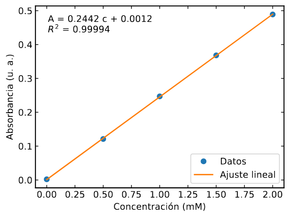

# Evaluación real de calidad y costo: 2 de noviembre de 2026

La batería está ejecutada: **93 casos, 186 consultas reales**, una con el modelo principal y
otra con su alternativa. Se revisaron formato, contenido y compilación. Hay defectos por
corregir; una respuesta bien formada no garantiza que el LaTeX o la explicación sean correctos.

Las rutas y esfuerzos efectivos del servidor se consultaron antes de la prueba y coincidían
con `config.mjs`. Los casos usan exclusivamente datos sintéticos. El evaluador funciona fuera
del producto: conserva las respuestas en artefactos locales y no usa cuentas, saldos ni eventos
de estudiantes. No se modificaron las instrucciones ni las rutas publicadas para obtener estos
resultados. No se hizo una segunda pasada para sustituir respuestas desfavorables.

## Resultado medido

| Comprobación                                    | Resultado                                                                         |
| ----------------------------------------------- | --------------------------------------------------------------------------------- |
| Casos / respuestas completas                    | 93 / 186                                                                          |
| Errores de API / respuestas cortadas            | 0 / 0                                                                             |
| Formatos estructurados válidos                  | 115 de 116; incluyen 11 abstenciones sin cambios                                  |
| Compilaciones de documentos y fragmentos        | 130 de 136 generan PDF                                                            |
| Fallos de compilación                           | 5 requieren corrección; 1 depende de una figura ausente que la respuesta advierte |
| Gráficas generadas por los modelos y ejecutadas | 6 de 6 producen PDF                                                               |
| Respuestas con correcciones registradas         | 13: 5 principales y 8 alternativas                                                |
| Propuestas bloqueadas por el servidor           | 1 alternativa, por cambiar una fórmula protegida                                  |
| Otras observaciones registradas                 | 10: 3 principales y 7 alternativas                                                |

«Sin hallazgos registrados» describe esta revisión por Codex, no una aprobación humana
independiente ni una garantía de corrección. Los hallazgos están individualizados en
[la revisión](../revisiones/2026-11-02.json); las [métricas CSV](2026-11-02-metricas.csv) permiten
rastrear cada respuesta y el [resumen JSON](2026-11-02-resumen.json) contiene los totales.

## Costo y tiempo

Importes calculados con el uso que devolvieron las API y las tarifas configuradas en el programa:

| Ruta        | Consultas | Costo total   | Media por consulta | Mediana de respuesta completa |
| ----------- | --------- | ------------- | ------------------ | ----------------------------- |
| Principal   | 93        | $0,306177     | $0,003292          | 3,484 s                       |
| Alternativa | 93        | $0,368861     | $0,003966          | 4,686 s                       |
| Total       | 186       | **$0,675038** | $0,003629          | 3,987 s                       |

| Modelo            | Consultas | Costo con la configuración del programa |
| ----------------- | --------- | --------------------------------------- |
| GPT-6.1 Terra     | 80        | $0,146509                               |
| Claude Haiku 5.5  | 56        | $0,026613                               |
| Claude Sonnet 5.5 | 37        | $0,400324                               |
| GPT-6.1 Sol       | 13        | $0,101592                               |

Se registraron 193 935 tokens de entrada y 97 583 de salida, incluido el razonamiento que
informa el proveedor. Cada modelo atendió tareas y esfuerzos distintos: estos totales no son
una clasificación de calidad entre modelos. La comparación relevante es la pareja del mismo caso.
Las llamadas de esta muestra se iniciaron entre las 20:55 y las 21:00 UTC del 2 de noviembre.

**Diferencia encontrada en precios:** el programa configura la lectura de caché de Sonnet en
$0,20 por millón de tokens; la [tarifa oficial consultada](https://platform.claude.com/docs/en/about-claude/pricing)
publica $0,10. Con esa tarifa y el mismo uso, el importe calculado es **$0,673201**; la diferencia
es $0,001837. Las demás tarifas usadas coinciden con las páginas de
[OpenAI](https://developers.openai.com/api/docs/pricing) y Anthropic para estas llamadas.
La actualización de esa tarifa queda como corrección pendiente. Estos cálculos se redondean
por consulta a microdólares; no son una conciliación de la factura ni incluyen impuestos.

La muestra tiene proyectos pequeños. Su costo medio no estima el de un proyecto de 150 000
tokens ni cuántas consultas permitirá siempre el crédito mensual.

## Ejemplos que funcionaron

### Gráfica desde datos: valores conservados y ajuste reproducible

Solicitud: «Dibuja absorbancia vs concentración con ajuste lineal, unidades y R²».
Los dos modelos de esa ruta produjeron, al ejecutar sus scripts aislados:

- pendiente: **0,24420 mM⁻¹**;
- intercepto: **0,00120**;
- R²: **0,999939**.



En el caso que pedía un espectro con los mismos datos, ambos avisaron de que el eje era
concentración, no longitud de onda. No se inventaron un espectro ni picos en una serie creciente.
Los seis scripts se revisaron y ejecutaron sin red, con NumPy 2.2.6, SciPy 1.15.3 y Matplotlib 3.10.3.

### Chat con PDF: respuesta anclada a una página

Solicitud: «¿Se informa un intervalo de confianza? Si no consta, dilo».
GPT-6.1 Terra respondió:

> No. El documento indica que **no se estimó un intervalo de confianza** (estudio.pdf, p. 2).

Coincide con la página sintética del caso. La alternativa también señaló esa página y evitó
inventar pendiente, ordenada o incertidumbres que el texto no proporcionaba.

### Protección de fórmulas: una propuesta rechazada correctamente

En `fase2-revisar_entrega-2`, Claude Haiku propuso mover la unidad al interior de una fórmula:

```latex
% Antes
La concentración estimada fue $c=2$ mM.
% Propuesta
La concentración estimada fue $c=2\,\text{mM}$.
```

El contrato de esa función exige conservar las fórmulas literalmente. El validador rechazó
la respuesta completa con «La propuesta alteró un comando, una cita o una fórmula».
La comprobación del servidor funcionó; esa propuesta no llegaría a ofrecerse para aplicar.

## Ejemplos que requieren corrección

### Fórmula desde texto: falta un paquete

Para «Matriz de rotación de dos dimensiones con ángulo theta», el modelo principal
(GPT-6.1 Terra, esfuerzo bajo) propuso:

```latex
\[
R(\theta) = \begin{pmatrix}
\cos\theta & -\sin\theta \\
\sin\theta & \cos\theta
\end{pmatrix}
\]
```

No declaró `amsmath`, necesario para `pmatrix`. El fragmento falla con un preámbulo básico.
La alternativa usó `array` del núcleo y sí compiló. Es un fallo de calidad que el formato JSON
no detecta: la propuesta era válida para el servidor.

### Esqueleto de documento: un marcador rompe el título

Claude Sonnet, modelo principal de escritura, generó:

```latex
\title{Informe de laboratorio de Física II:\\ [Título de la práctica]}
```

El corchete después de `\\` se interpreta como su argumento opcional de distancia, que espera
una longitud. El documento falla en `\maketitle` con `Missing number, treated as zero`.
El marcador debe agruparse o separarse de esa sintaxis. No basta con que el JSON sea válido.

### Tutor: explicación falsa aunque el código compile

En la comparación de `equation` y `align`, GPT-6.1 Terra afirmó:

> Ambos requieren el paquete `amsmath`.

`equation` pertenece al núcleo de LaTeX; `align` sí requiere `amsmath`.
En la misma batería hay un ejemplo con `equation` sin ese paquete que compila correctamente.
Este fallo se detecta por contenido, no por compilación.

### Advertencia de hyperref: el PDF aparece, pero el aviso sigue

El modelo principal propuso:

```latex
\section{Energía \texorpdfstring{$E=mc^2$}{E=mc^2}}
```

La segunda versión conserva `^`. El registro sigue mostrando `Token not allowed in a PDF
string` y `removing superscript`: no resuelve la advertencia solicitada. La alternativa usó
texto plano para el marcador.

### Revisión académica: un diagnóstico de referencias sin fundamento

La alternativa de `revisor_jurado` afirmó que poner `\label{sec:metodo}` al final del párrafo
impedía obtener el número de sección. En el fixture no aparece otro contador intermedio;
el archivo auxiliar contiene:

```latex
\newlabel{sec:metodo}{{1}{1}{}{section.1}{}}
```

La referencia es correcta. Acercar la etiqueta al encabezado puede ser una recomendación
organizativa, pero no debe presentarse como un error demostrado del documento.

### Estructura de informe: datos no aportados por el estudiante

La alternativa del caso base de informe introdujo longitudes y periodos de un péndulo y luego
los llamó «datos obtenidos». El usuario pidió una estructura y no proporcionó esas mediciones.
Deben quedar vacías o identificarse expresamente como valores ficticios de ejemplo.

## Alcance y comprobación

- Misma asignación por **función, nivel y esfuerzo** que en producción. El evaluador antiguo
  elegía el primer esfuerzo asociado a cada modelo y no bastaba para esta comprobación.
- Modelos principal y alternativo consultados por separado: no simula una caída de proveedor
  para demostrar el cambio automático del enrutador. No hubo errores de API en esta ejecución.
- Salida estructurada y validadores de cambios, comentarios, bibliografía y documentos del producto.
- Los fragmentos se compilaron con un preámbulo de prueba y los paquetes indicados por la
  respuesta. El caso de advertencia de hyperref presupone ese paquete según su propio log.
  Los ejemplos didácticos de figuras usaron imágenes sustitutas; esos archivos no son datos
  de estudiantes. No se confunde esto con compilar cualquier proyecto real completo.
- 119 compilaciones locales correctas; las otras 17 se contrastaron en contenedores aislados
  con el digest TeX Live de producción `sha256:07e8062637249c4f780ca59f42cc2ed592bc2dc1db4320769406aee3f98aa70e`.
  Once de esas 17 generaron PDF. Cinco fallan y el sexto necesita la figura ausente advertida.
  El contraste no creó cuentas ni proyectos de Overleaf y eliminó sus carpetas temporales.
- La compilación usa pdfLaTeX sin shell escape; no se certifica la resolución final de toda
  bibliografía con Biber ni se ha realizado una revisión visual de cada página de los 136 documentos.
- Docker Desktop/WSL local dejó de responder durante el contraste. No se reiniciaron servicios
  ajenos. La comprobación pendiente se completó con contenedores temporales sin red, memoria y
  CPU limitadas, en la VM que ya tenía el TeX Live correspondiente. Esta incidencia no se cuenta
  como un error de los modelos.
- Revisión semántica asistida por Codex, con hallazgos por respuesta. Una ejecución sintética
  no mide estabilidad entre repeticiones ni reemplaza la revisión humana de un jurado.

## Correcciones pendientes

1. Corregir la tarifa de lectura de caché de Sonnet en el catálogo de precios.
2. Reforzar y volver a probar la generación de fórmulas y plantillas: paquetes, marcadores y avisos.
3. Ajustar las explicaciones del tutor y la revisión de referencias; no marcar como errores
   hechos que el documento no permite demostrar.
4. Repetir los casos que fallaron tras las correcciones, manteniendo visible esta primera pasada.
